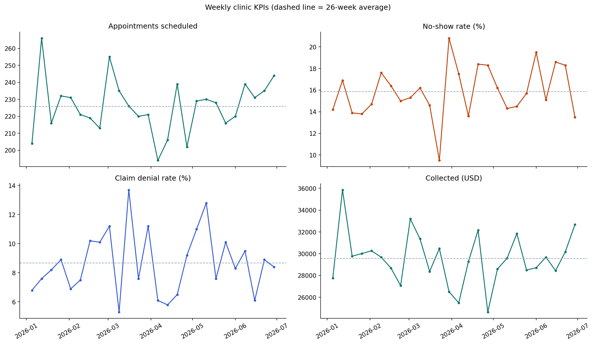
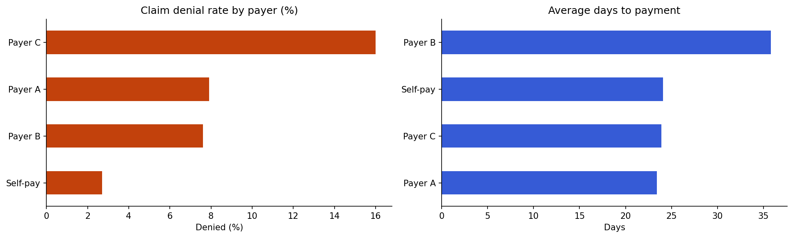

# Healthcare KPI Data Pipeline (Python + SQL)

An ETL pipeline that turns messy clinic exports into validated weekly KPIs: appointment volume, no-show rate, claim denial rate, collections, and days to payment.

> **All data in this repository is synthetic.** It is generated by [`src/generate_synthetic_data.py`](src/generate_synthetic_data.py). No real patients, clinics, or payers are represented.

**Author:** Oluwatoyin Olawale Akadiri · [oluwatoyinakadiri.com](https://oluwatoyinakadiri.com)

## Pipeline
```
raw CSVs ──► clean (Python) ──► validate (8 checks) ──► load (SQLite) ──► KPI views (SQL) ──► weekly KPIs
```
| Stage | File | What it does |
|---|---|---|
| Extract and clean | [`src/etl.py`](src/etl.py) | Parses three date formats, maps 8 clinic-name variants to 3 clinics, strips currency symbols, removes duplicates, missing statuses, impossible dates, negative amounts, and orphaned claims, and logs every removal |
| Validate | [`src/etl.py`](src/etl.py) `validate()` | Unique IDs, valid statuses, non-negative lead times, positive amounts, every claim linked to an appointment. The load stops if any check fails |
| Load | [`src/etl.py`](src/etl.py) `load()` | Writes clean tables, the validation results, and the cleaning log to SQLite |
| KPIs | [`sql/kpi_views.sql`](sql/kpi_views.sql) | `weekly_kpis`, `clinic_kpis`, `payer_kpis` views (CTEs, joins, conditional aggregation) |

## Results (synthetic data)
- **Cleaning:** 6,060 appointment rows → 5,872 clean (60 duplicates, 114 missing statuses, 15 booked-after-visit dates removed); 4,688 claims → 4,669 (10 non-positive amounts, 9 orphaned claims).
- **Validation:** all 8 checks pass before loading.
- **No-shows rise with lead time:** 9.3% for bookings 0-3 days out vs 35.6% for 30+ days; Downtown Clinic is highest at 19.2%.
- **Revenue cycle:** Payer C denies 16.0% of claims (about twice the others); Payer B takes longest to pay (35.8 days on average).




## Repository structure
```
├── data/raw/                      # synthetic, messy input CSVs
├── notebooks/healthcare_kpi_pipeline.ipynb
├── sql/kpi_views.sql
├── src/generate_synthetic_data.py
├── src/etl.py
├── tests/test_etl.py              # unit and end-to-end tests
└── images/
```

## How to run
```bash
pip install -r requirements.txt
python src/generate_synthetic_data.py   # optional: regenerate the data
python src/etl.py                       # builds clinic_kpis.db and outputs/weekly_kpis.csv
pytest tests
```

## Limitations
The data is synthetic and its patterns were built into the generator, so the results show the method, not real clinic behavior. A production version would run on a schedule against a database or API and feed a BI dashboard (for example Power BI) from the KPI views.

## License
MIT
